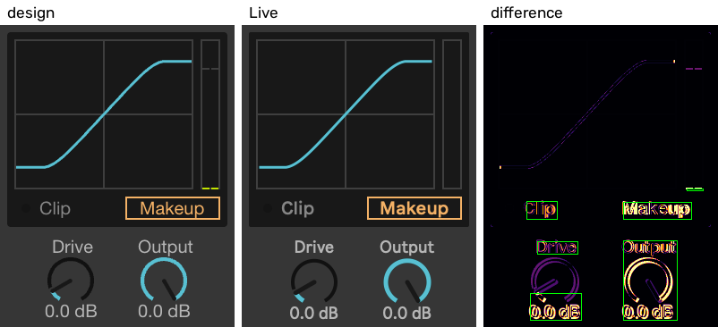

# m4l-loop

Make a Max for Live device match its design, pixel by pixel, in a running copy of Ableton Live.

`m4l-loop` builds your device from a Python spec and swaps it into Live in place, keeping its settings. It then screenshots it, lines it up with your HTML design, and tells you how far off each element is:

```
match 96.7 %
  display          off by [0, 0]      residual 1.4
  clip label       off by [0, 0]      residual 6.8
  drive value      off by [1.5, 1.0]  residual 7.7
```

It can also drive Live for you: load a native device (Saturator, EQ Eight, …) next to yours as a reference, set parameters, play audio, and screen-record both, so you can match how things **move** as well as how they look.



## How it works
```
device.py ──build──▶ .amxd in your User Library ──UDP──▶ M4LLoop remote script swaps it into Live
                                                                   │
design.html ──headless Chrome──▶ reference image                   ▼
            └────────────── compare ◀─────────── screenshot of Live's window
                               │
              compare.png + report.json (per-element offsets)
```

## Requirements
- macOS, Ableton Live 12 Suite (or Standard with Max for Live), Max 9 (bundled with Live)
- Python 3.10+, Google Chrome, the Xcode command-line tools (`swiftc`)
- Screen Recording permission for your terminal

## Quick start
```bash
git clone https://github.com/robertbenjamin/m4l-loop && cd m4l-loop
python3 -m venv .venv && .venv/bin/pip install -r requirements.txt
.venv/bin/python -m m4l_loop setup examples/mackity/device.py
```
Then, once:
1. Restart Live.
2. Open **Settings → Link, Tempo & MIDI**.
3. In a free **Control Surface** slot, pick **M4LLoop**, with Input and Output set to None.

After that, iterate:
```bash
.venv/bin/python -m m4l_loop loop  examples/mackity/device.py   # build, swap in, compare
.venv/bin/python -m m4l_loop watch examples/mackity/device.py   # same, on every save
```
Results are written to `m4l-loop-out/<Name>/`: `compare.png`, `report.json`, `live.png`, `ref.png`.

When it's done, freeze it into one self-contained file to share, with its scripts and its macOS and Windows externals inside:
```bash
.venv/bin/python -m m4l_loop freeze  examples/mackity/device.py   # ~/Desktop/Mackity.amxd
.venv/bin/python -m m4l_loop inspect ~/Desktop/Mackity.amxd       # what's inside, and for which systems
```

## Your own device
1. A **design page**: HTML that draws the device and supports `?ref=1&zoom=Z&theme=T` (see [the reference contract](docs/device-spec.md#the-reference-page)).
2. A **device spec**: a `.py` file with `NAME`, `WIDTH`, `REFERENCE`, `ELEMENTS` and `build()` (see [docs/device-spec.md](docs/device-spec.md)). `m4l_loop.patch` writes the Max patch for you.
3. Run `setup` once, then `loop` until the report is clean.

## Docs
| | |
|---|---|
| [Workflow](docs/workflow.md) | The loop step by step, comparing against native devices, matching animation |
| [Device spec](docs/device-spec.md) | Spec fields, the reference page contract, the report |
| [Live control](docs/live-control.md) | Every remote-script command |
| [Sharing](docs/sharing.md) | Freezing, covering macOS and Windows, building Windows externals on a Mac, proving a file is self-contained |
| [Gotchas](docs/gotchas.md) | Live, Max, v8ui and capture facts that matter when matching pixels |
| [Principles](docs/principles.md) | How to work so that every change is measured, not guessed |

The Mackity example is styled with a companion design system: [Live Device Kit](https://claude.ai/artifact/Uww7TVHaywVZU3KgZiKhMs), which holds measured Live 12 layout, colour and behaviour rules.

## Layout
```
m4l_loop/          the tool (python -m m4l_loop)
remote_script/     M4LLoop, the Live remote script
examples/mackity/  a complete example: spec, display script, design page
docs/              guides
.claude/skills/    a Claude Code skill that runs the workflow
```

## License
MIT
